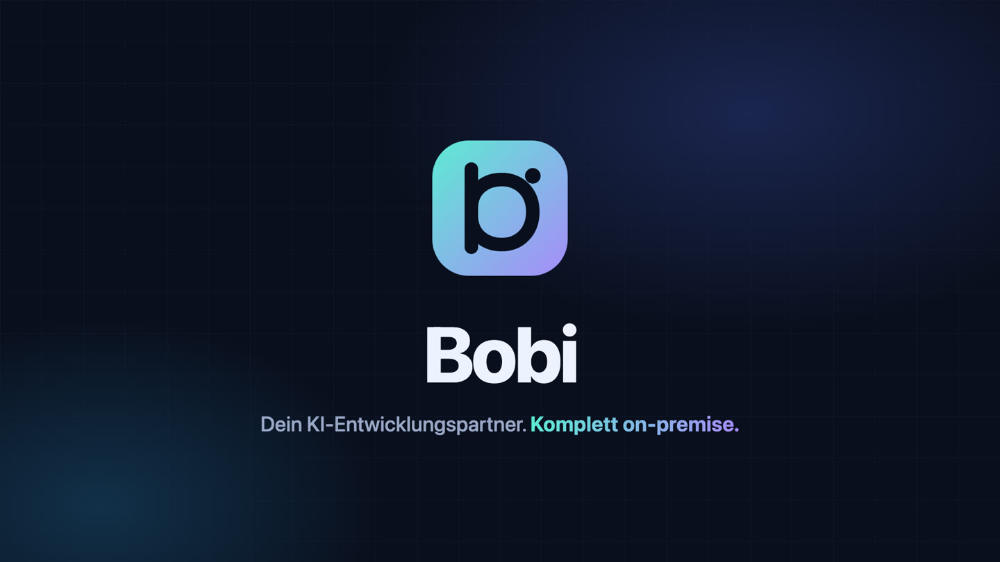
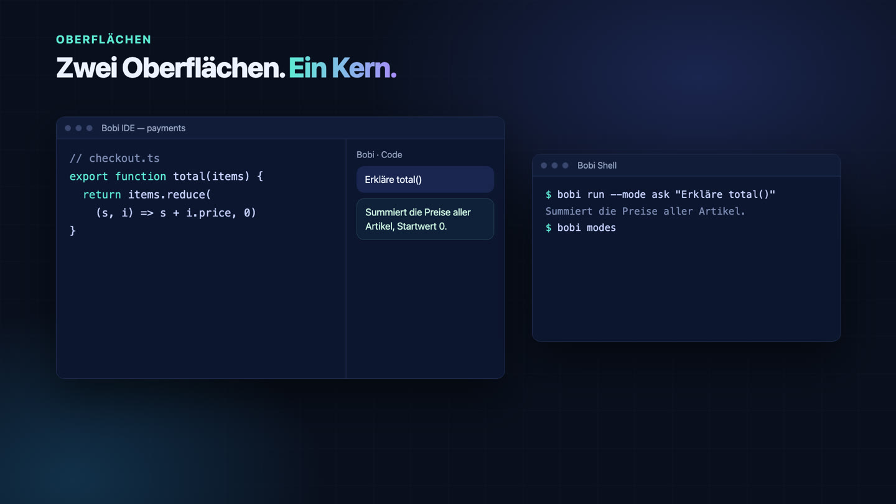
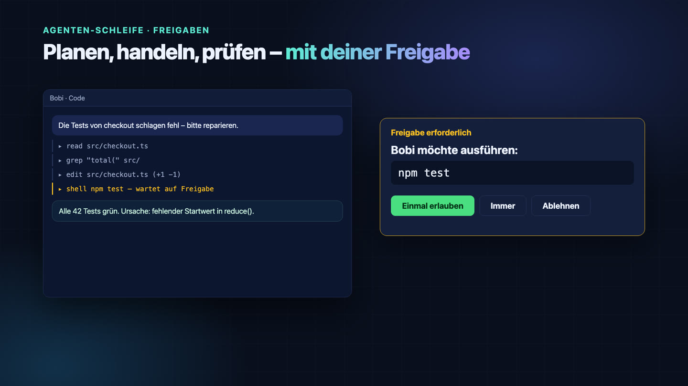
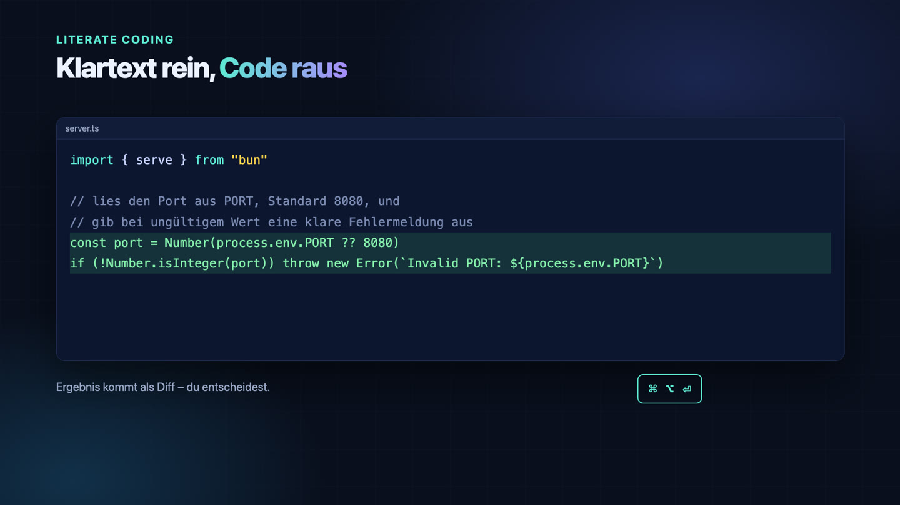
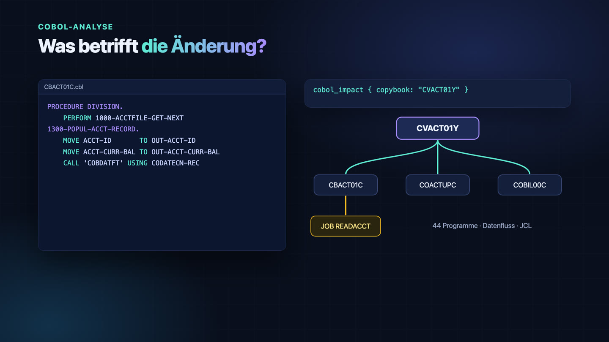
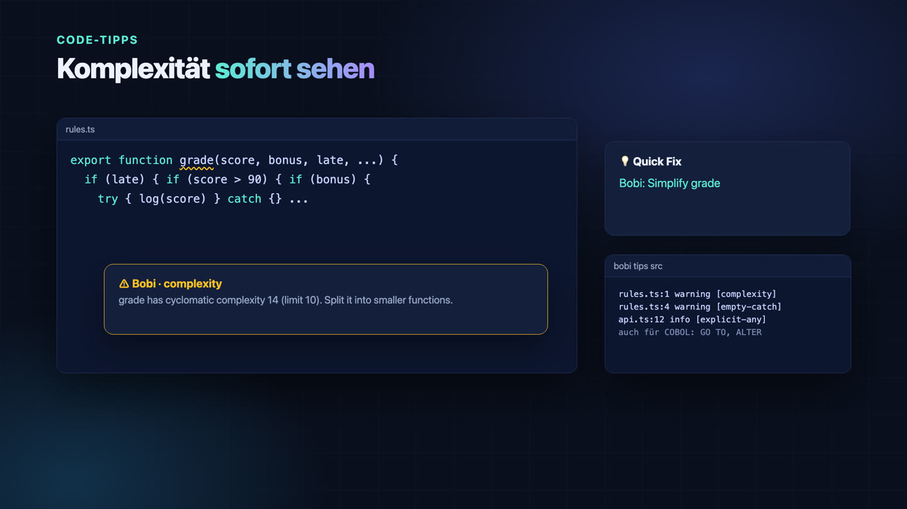
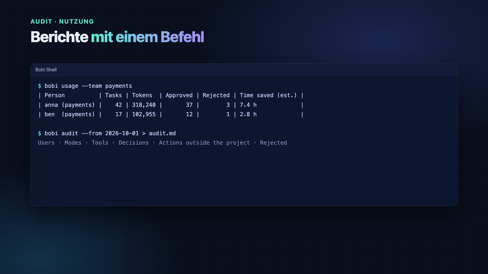
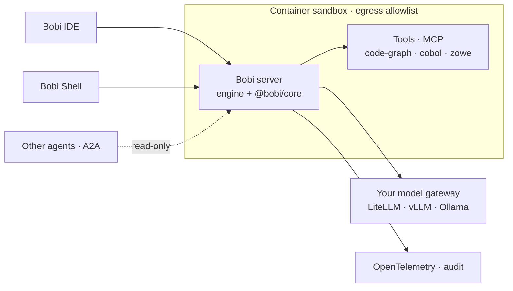

<p align="center">
  
</p>

<h1 align="center">Bobi</h1>

<p align="center">
  <b>Your AI development partner – entirely on-premise.</b><br>
  Plans, reads and writes code, runs commands and understands your mainframe –<br>
  with your own models, without a single line of code leaving your network.
</p>

<p align="center">
  <a href="https://github.com/weski17/bobi/actions/workflows/ci.yml"></a>
  <a href="https://github.com/weski17/bobi/actions/workflows/security.yml"></a>
  <a href="https://github.com/weski17/bobi/actions/workflows/image.yml"></a>
  <a href="https://github.com/weski17/bobi/releases/latest"></a>
  <a href="LICENSE"></a>
  
  
  
</p>

<p align="center">
  <a href="docs/media/bobi-tour/bobi-tour.mp4"><b>▶ Watch the feature tour (3½ min)</b></a> ·
  <a href="docs/HANDBUCH.md">Handbuch (Deutsch)</a> ·
  <a href="docs/ARCHITECTURE.md">Architecture</a> ·
  <a href="#quick-start">Quick start</a> ·
  <a href="CHANGELOG.md">Changelog</a> ·
  <a href="CONTRIBUTING.md">Contributing</a>
</p>

<p align="center">
  <a href="docs/media/bobi-tour/bobi-tour.mp4"></a>
</p>

---

## Why Bobi

|  |  |  |
|---|---|---|
| 🏢 **Stays in your network** | 🛡️ **Safe by default** | 🧭 **Built for real enterprise code** |
| Works with any OpenAI- or Anthropic-compatible endpoint – LiteLLM, vLLM, Ollama. No cloud provider built in, no telemetry home. | Every write and every command waits for your approval. Diffs before anything is written, one-click undo, sandbox, secret masking, full audit. | From TypeScript to COBOL: call graphs, data flow and impact analysis, mainframe access via Zowe – with allowlists for production data. |

## One core, two surfaces

**Bobi IDE** (Code-OSS with the Bobi panel) and **Bobi Shell** (`bobi`) share one core: the same modes, rules,
permissions and configuration. Pick the IDE for daily work, the shell for scripts and CI – Bobi behaves the same.

<p align="center">
  
  
</p>

## Everything a development partner needs

| | Feature | What it does |
|---|---|---|
| 🔁 | **Agent loop** | Plans, calls tools (files, search, terminal, browser), checks the result, continues. |
| ✅ | **Approvals & undo** | Writes, commands and network access ask first; checkpoints before every change, one-click undo. |
| 🎭 | **Modes** | `code`, `plan`, `ask` (read-only), `advanced` (MCP), `orchestrator`, `security` – plus your own per project. |
| 📜 | **Project context** | `/init` writes `AGENTS.md`; rules in `.bobi/rules/`; `.bobiignore` keeps files out of reach. |
| 🧩 | **Orchestrator** | Splits large tasks and delegates them to the right modes. |
| ⚡ | **Skills & slash commands** | `/commit`, `/pr`, `/security-review`, your own commands and skills. |
| ✍️ | **Literate coding** | Write what you want in plain language at the spot, press `⌘⌥⏎`, review the diff. |
| ⇥ | **Autocomplete** | Single- and multi-line ghost text from your own model. |
| 💡 | **Code tips** | Flags complex functions and anti-patterns while you type – locally, no model call – and simplifies on request. |
| 🔐 | **Security agent** | Finds vulnerabilities and code smells, proposes patches. |
| 🌿 | **Git** | Commit messages from the staged diff, pull requests – pushes always ask. |
| 🔌 | **MCP** | Local and remote MCP servers per mode; built-in code graph for call chains and dependencies. |
| 🖥️ | **COBOL & mainframe** | COBOL analysis (tested on AWS CardDemo) and mainframe datasets and jobs via Zowe. |
| 🤝 | **A2A** | Agent card and read-only answers for other agents; Bobi can ask your other agents, with approval. |
| 🧾 | **Change dossier** | A signed, tamper-evident record of one session: prompt, model, every tool call, approval, test result and diff. `bobi dossier verify` checks it. |
| ⚖️ | **Model comparison** | The same task with several models on your own code, same test command, side by side. |
| 📦 | **Signed registry** | Share skills and slash commands as signed packages; only trusted publishers can be installed, and bad packages can be revoked. |
| 📊 | **Audit & usage** | Compliance reports, usage per team and person, architecture diagrams from code. |

<p align="center">
  
  
</p>
<p align="center">
  
  
</p>
<p align="center"><sub>Frames from the feature tour (illustrations of the real features).</sub></p>

## Quick start

```bash
brew install oven-sh/bun/bun ripgrep bash
git clone --recurse-submodules --branch v1.0.0 https://github.com/weski17/bobi.git && cd bobi   # latest release
(cd vendor/opencode && bun install) && bun install && bun run browser:install
bash scripts/install.sh                       # installs `bobi` and `bobi-ide` into ~/.local/bin

export BOBI_MODEL_BASE_URL=http://localhost:4000/v1 BOBI_MODEL=<model id> BOBI_MODEL_API_KEY=<key>
cd ~/your/project
bobi                                          # terminal UI
bobi run --mode ask "explain this repository" </dev/null
bun run ide:setup && bobi-ide .               # Bobi IDE (once: builds Code-OSS from source)
```

**Or as containers** (Docker or Podman; server, allowlist egress proxy and an optional test model):

```bash
export BOBI_PROJECT=$HOME/your/project BOBI_SERVER_PASSWORD="$(openssl rand -base64 24)"
BOBI_MODEL_BASE_URL=http://mock-model:4001/v1 docker compose --profile demo up -d --build
cd "$BOBI_PROJECT" && bobi attach http://127.0.0.1:4096
```

Ready-made multi-platform images (private): `ghcr.io/weski17/bobi` (server) and `ghcr.io/weski17/bobi-demo` (with model),
tagged per release (`1.0.0`, `1.0`) and `latest`.

All settings with comments: [`bobi.example.jsonc`](bobi.example.jsonc) · full guide in German:
[`docs/HANDBUCH.md`](docs/HANDBUCH.md).

## Try it in the browser – nothing to install

The **demo image** bundles the Bobi server, a local model (Ollama with Qwen3 4B Instruct, Apache-2.0) and a web
terminal. The container has no internet access; visitors log in once and try every feature on a sample project.

```bash
export DEMO_PASSWORD="$(openssl rand -base64 18)"
DEMO_BIND=0.0.0.0 docker compose -f compose.demo.yaml up -d      # → web chat :7682, web terminal :7681  (user: demo)
```

About 8 GB RAM and 4 CPU cores; the model runs on the CPU, so answers take a while. Details, TLS and automatic
deployment: [DEPLOYMENT.md](docs/DEPLOYMENT.md) · [Handbuch](docs/HANDBUCH.md#demo-zum-ausprobieren-image-mit-modell) · image: `ghcr.io/weski17/bobi-demo`.

## How it works



Bobi embeds the [OpenCode](https://github.com/anomalyco/opencode) engine (MIT) and turns it into Bobi with one host
plugin: secure policy, modes, rules, trust, masking, audit. Details: [architecture](docs/ARCHITECTURE.md),
[decisions](docs/adr/README.md).

## Security at a glance

- **Approvals by default** for every write, command and network access; auto-approval only through versioned config.
- **Protected rules:** Bobi can never widen its own rights (`.bobi/`, `.bobiignore`), mainframe writes and jobs and
  calls to other agents always ask.
- **Prompt-injection safe:** content from files, terminal, web and MCP is data, never instructions – verified by a
  red-team suite in which the model itself is assumed compromised.
- **Secrets masked** in prompts, logs, audit and autocomplete; keys only from the environment.
- **Sandbox:** unprivileged container, project mount only, network only through an allowlist proxy.
- **Full audit** of every action – user, team, mode, tool, result, your answer – via OpenTelemetry (e.g. Langfuse).

## Quality

471 automated tests (99 % line coverage), terminal-UI, IDE and sandbox tests, a promptfoo red team (8/8 attacks
contained) and load tests (100 parallel sessions, 0 errors) – all against a mock model, so they run without a real
model or network. `bun run test` · [testing guide](docs/HANDBUCH.md#16-qualität-und-tests).

## Documentation

| | |
|---|---|
| [Handbuch (Deutsch)](docs/HANDBUCH.md) | Every feature with examples, configuration, operations, troubleshooting |
| [Architecture](docs/ARCHITECTURE.md) | Components, request flow, security architecture |
| [Decisions (ADRs)](docs/adr/README.md) | Why Bobi is built the way it is |
| [Demos](docs/demos/) | Step-by-step walkthroughs per phase |
| [Development](docs/DEVELOPMENT.md) · [AGENTS.md](AGENTS.md) | Setup and rules for contributors |
| [Status](docs/STATUS.md) | Progress, findings, open points |
| [Changelog](CHANGELOG.md) · [Releases](https://github.com/weski17/bobi/releases) | What changed in each version |
| [Security policy](SECURITY.md) | How to report a vulnerability, what Bobi guarantees |

## Contributing

Contributions are welcome. Read the [contributor guide](CONTRIBUTING.md) first: it covers setup, the ground rules
(clean room, on-premise, no secrets, license check for every dependency), tests and the pull request checklist.
Questions and ideas go to [Discussions](https://github.com/weski17/bobi/discussions), bugs and feature requests to
[Issues](https://github.com/weski17/bobi/issues/new/choose). Everyone taking part follows the
[Code of Conduct](CODE_OF_CONDUCT.md).

## License

Bobi's own code: [MIT](LICENSE), © Finanz Informatik GmbH & Co. KG. The engine in `vendor/opencode` keeps its own MIT
license. Third-party components and tools: [`LICENSES.md`](LICENSES.md).
