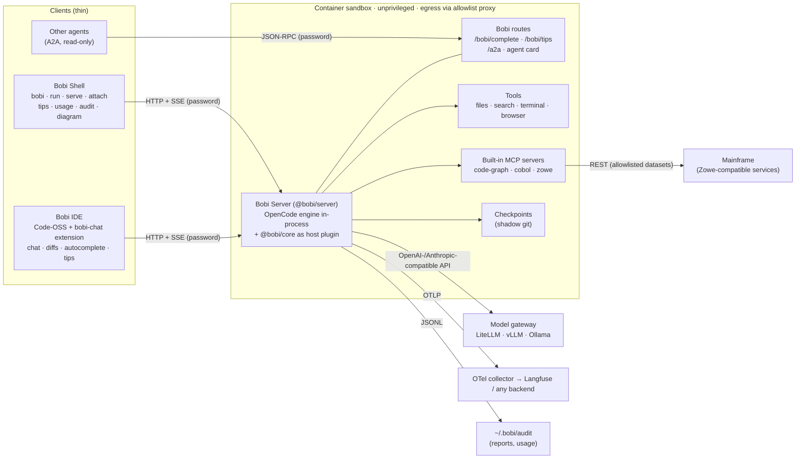

# Bobi – Architecture

Status: **implemented** (phases 0–7, 2026-10-20). Decisions are recorded in [`docs/adr/`](adr/README.md); the
upstream analysis that led to them is in [`docs/analysis/`](analysis/). German user documentation:
[`HANDBUCH.md`](HANDBUCH.md).

## 1. Overview



**One core, two surfaces.** All behaviour – modes, rules, permissions, configuration, audit – lives in the server
process. The IDE and the shell are thin clients; neither implements agent logic. Other agents reach the same core
through A2A, restricted to reading.

## 2. Packages

| Package | Responsibility | ADR |
|---|---|---|
| `vendor/opencode` | Engine: agent loop, tools, permissions, snapshots, MCP client, SQLite, HTTP API (pinned submodule, minimal patches) | 0001, 0002 |
| `packages/core` (`@bobi/core`) | The host plugin that makes the engine Bobi: secure policy and protected rules, modes as agents, rules/AGENTS.md, `.bobiignore`, project trust, secret masking, untrusted-data marking, audit (OTLP + JSONL incl. approvals, tasks, tokens), skills and commands, the read-only `a2a` agent, audit and usage reports, the signed change dossier and the signed registry for skills and commands (with revocation) | 0002, 0005, 0010, 0014, 0016–0018, 0022, 0023, 0025 |
| `packages/config` | `bobi.jsonc` schema, layering (global → project if trusted → `BOBI_CONFIG` → env), offline switches, trust store | 0003, 0014 |
| `packages/modes` | Built-in modes, `custom_modes.yaml`, tool groups → permission rules and visible tools | 0004 |
| `packages/server` | Embeds the engine on a Node HTTP server (WebSockets for terminals), password auth, checkpoint repos, Bobi routes (autocomplete, tips, A2A) | 0013, 0017, 0018 |
| `packages/shell` | The `bobi` application and its commands | 0009, 0013 |
| `packages/ide-extension` | Bobi chat panel for Bobi IDE: chat, diffs, literate coding, commit messages, autocomplete, code tips | 0008, 0016–0018 |
| `packages/web-chat` | The IDE chat panel as a web page: browser bundle of the same chat controller plus a gate that serves it and forwards only the chat's API calls | 0024 |
| `packages/browser` | Headless-browser tool (Playwright), one approval per page | 0007 |
| `packages/egress-proxy` | Allowlist proxy for the sandbox (one request per connection) | 0007 |
| `packages/a2a` | A2A agent card, inbound JSON-RPC handler, outbound client and `a2a` tool | 0017 |
| `packages/tips` | Code tips: TS/JS via the TypeScript AST, COBOL via the Bobi parser | 0018 |
| `packages/mock-model` | Scriptable OpenAI-compatible model (chat, tool calls, FIM, latency) for tests | 0011 |
| `mcp-servers/code-graph` | Call chains, dependencies, diagrams for TS/JS | 0015 |
| `mcp-servers/cobol` | COBOL parser, call graphs, data flow, impact analysis, JCL, diagrams | 0017 |
| `mcp-servers/zowe` | Mainframe datasets, USS and jobs over the Zowe-compatible REST services, allowlisted | 0017 |
| `vendor/code-oss` | Bobi IDE (Code-OSS, branding via `scripts/ide`, patches in `patches/code-oss`) | 0008, 0012 |

Rule: **Bobi code never lives inside `vendor/`.** Anything that must change there is a numbered patch in
`patches/<upstream>/`.

## 3. Repository layout

```text
bobi/
├── CLAUDE.md · AGENTS.md · README.md · LICENSE · LICENSES.md · bobi.example.jsonc
├── packages/            core · config · modes · server · shell · ide-extension · browser · egress-proxy · a2a · tips · mock-model
├── mcp-servers/         code-graph · cobol · zowe
├── vendor/              opencode (engine) · code-oss (IDE) · carddemo (COBOL test object)
├── patches/             opencode/ · code-oss/  (ordered, minimal, each with a reason)
├── branding/default/    icon.svg (Bobi IDE logo; company packs via BOBI_BRANDING_DIR)
├── compose.yaml         Docker/Podman Compose: server · egress · gateway · mock-model (ADR-0019)
├── compose.demo.yaml    Demo: server + local model + web terminal in one image, no internet (ADR-0020)
├── sandbox/             Containerfile (targets server, demo) · bobi-sandbox.sh · forward.ts · compose-masks.ts · demo/
├── scripts/             install.sh · apply-patches.ts · link-upstream.ts · bobiignore-paths.ts · ide/
├── tests/               integration · e2e · ide · sandbox · redteam (promptfoo) · load
└── docs/                HANDBUCH.md · ARCHITECTURE.md · STATUS.md · DEVELOPMENT.md · adr/ · demos/ · analysis/ · media/
```

What Bobi reads in a project it works on:

```text
<project>/
├── AGENTS.md               project description (/init writes it)
├── .bobiignore             files Bobi must never access
└── .bobi/
    ├── config.jsonc        models per mode, auto-approvals, MCP servers, tips thresholds
    ├── custom_modes.yaml   own modes; same slug overrides a built-in mode
    ├── rules/  rules-<mode>/
    ├── skills/<name>/SKILL.md
    └── commands/*.md
```

Project files are used only after the user trusts the project (fingerprint of these files; asked again on change).

## 4. A request, end to end

1. A client sends a prompt (`POST /api/session/:id/prompt`). The `prompt` hook records a `bobi.task` and switches to
   the mode's model if one is configured.
2. The `context` hook builds the system prompt: Bobi identity, the untrusted-data rule, the mode's role and
   project rules; tools the mode does not grant are removed.
3. The engine runs the agent loop against the model gateway. Every tool call passes `tool.execute.before`
   (`.bobiignore`, edit restrictions, A2A limits) and the permission engine (policy → auto-approvals → protected
   rules → mode deny rules, last match wins). `ask` reaches the user in the TUI or IDE.
4. Results pass `tool.execute.after`: ignored search hits removed, secrets masked, output from files, terminal,
   web and MCP wrapped as `<untrusted-data>`.
5. Every evaluation, answer, tool call and model step's tokens become audit records (OTLP and JSONL).
6. Edits are snapshotted first; *undo* reverts the request's changes.

## 5. Security architecture

| Concern | Mechanism |
|---|---|
| Data stays on-prem | Only the configured endpoint; engine vendor services disabled; tested |
| Approvals | Ask by default for writes, terminal, network, MCP; explicit versioned auto-approvals; protected rules always ask (`.bobi/`, `.bobiignore`, mainframe writes and jobs, `a2a`) |
| Prompt injection | Untrusted-data marking; permissions enforced by Bobi, never by the model; red-team suite with a compromised model |
| Secrets | Pattern and known-value masking in prompts, tool output, logs, audit, autocomplete; keys only from env |
| Isolation | Container sandbox (unprivileged, project mount only, `.bobiignore` paths masked by mounts), egress allowlist proxy |
| Foreign repositories | Project trust with fingerprint; no engine project config or plugins are ever loaded |
| Other agents | A2A off by default, global switch only; hidden `a2a` agent = built-in Ask mode, everything else denied |
| Mainframe | Dataset/USS allowlist (default: own datasets), DSN checks in JCL, TLS always verified |
| Accountability | Audit of every action with user, team, mode, tool, result and the user's answer |

## 6. Requirement mapping

| # | Requirement (CLAUDE.md) | Where | Phase |
|---|---|---|---|
| 1 | Agent loop | engine `session/runner` | 1 |
| 2–3 | Modes, own modes | `packages/modes`, `@bobi/core` | 2 |
| 4 | Files, search, terminal, browser | engine tools, `packages/browser` | 1 |
| 5 | Approvals | `packages/core/defaults/permissions.jsonc`, protected rules | 1 |
| 6 | Checkpoints, one-click undo | engine snapshots, shadow repos (`packages/server`) | 1 |
| 7 | `/init`, rules, `.bobiignore` | `@bobi/core` | 2 |
| 8 | MCP client per mode | `@bobi/core/mcp`, `packages/modes` | 3 |
| 9 | IDE: chat, tab context, inline diffs | `packages/ide-extension` | 4 |
| 10 | Orchestrator | `subtask` group, engine `subagent` | 5 |
| 11 | Skills, slash commands | `@bobi/core/extensions` | 5 |
| 12 | Literate coding | IDE command `bobi.literate` | 5 |
| 13 | Security agent | `security` mode, `/security-review` | 5 |
| 14 | Code tips | `packages/tips`, `/bobi/tips`, IDE diagnostics, `bobi tips` | 7 |
| 15 | Git | `/commit`, `/pr`, IDE commit button | 5 |
| 16 | Own MCP servers | `mcp-servers/code-graph`, `cobol`, `zowe` | 3, 6 |
| 17 | Autocomplete | `/bobi/complete`, IDE inline completion | 6 |
| 18 | Audit reports, diagrams | `bobi audit`, `bobi diagram` | 6 |
| 19 | Usage statistics | `bobi usage` | 7 |
| 20 | A2A | `packages/a2a` | 6 |
| – | Signed change dossier | `@bobi/core/dossier`, `bobi dossier` | 8 |
| – | Model comparison | `packages/shell/src/compare.ts`, `bobi compare` | 8 |
| – | Signed registry (skills, commands), revocation | `@bobi/core/registry`, `@bobi/core/revocation`, `bobi registry` | 8 |
| – | Web chat | `packages/web-chat` | 8 |
| – | Tips as a pull request check | `packages/tips/src/ratchet.ts`, `bobi tips --since` | 8 |

## 7. Quality gates

`bun run test:coverage` (≥ 80 % lines/functions; currently 98 %), typecheck, Semgrep and the promptfoo red team in
CI; IDE, terminal-UI, sandbox and load tests locally. See [HANDBUCH §16](HANDBUCH.md#16-qualität-und-tests).
