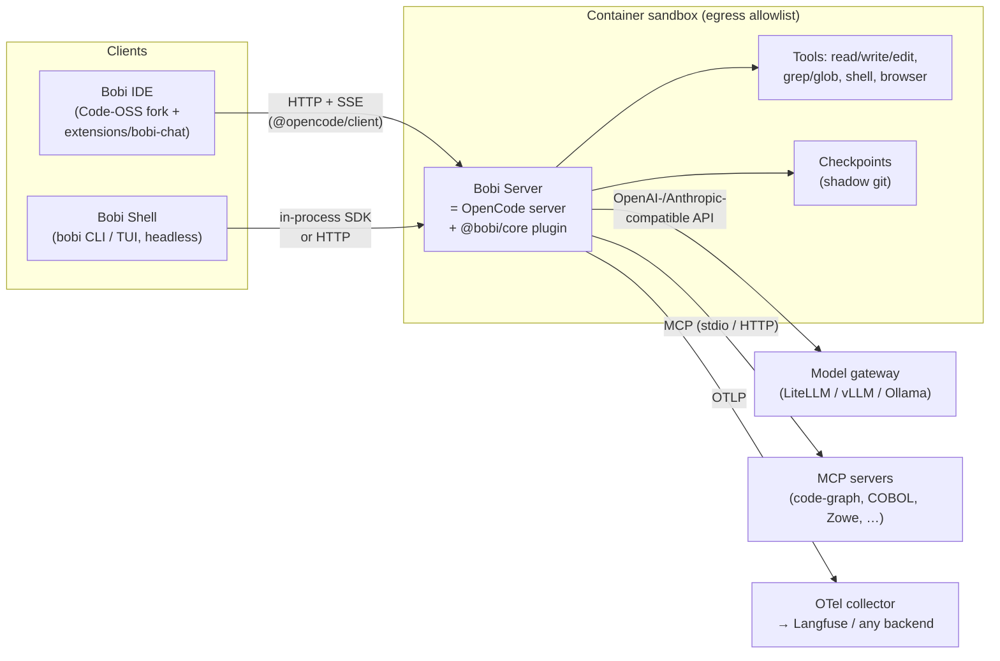

# Bobi – Architecture (proposal, Phase 0)

Status: **Proposed** – awaiting approval. Decisions are recorded in [`docs/adr/`](adr/).
Analysis inputs: [OpenCode](analysis/opencode.md), [Code-OSS](analysis/code-oss.md).

## 1. Overview



**One core, two surfaces.** All behaviour (modes, rules, permissions, config) lives in the server process.
IDE and Shell are thin clients; they never implement agent logic themselves.

## 2. Layering

| Layer | What | Where | Upstream change |
|---|---|---|---|
| Engine | Agent loop, tools, permissions, snapshots, MCP, SQLite, HTTP API | `vendor/opencode` (fork, pinned tag) | Minimal patch series only |
| **Bobi core** | Modes, `.bobi/` loader, `.bobiignore`, secure defaults, secret masking, audit spans, model routing, browser tool | `packages/core` (`@bobi/core`, an OpenCode plugin) | None – uses plugin API |
| Config | `bobi.jsonc` + env → OpenCode config | `packages/config` (`@bobi/config`) | None |
| Shell | `bobi` binary: starts engine with Bobi plugin + env, rebranded TUI/CLI | `packages/shell` (`@bobi/shell`) | Small branding patches |
| IDE | Code-OSS fork with Bobi branding; chat panel as built-in extension | `vendor/code-oss` + `packages/ide-extension` → `extensions/bobi-chat` | `product.json` overlay + small patch series |
| MCP servers | code-graph, COBOL, Zowe | `mcp-servers/*` | – |

Rule: **Bobi code never lives inside `vendor/`.** Anything that must change there is a numbered patch in `patches/<upstream>/`.

## 3. Folder structure

```text
bobi/
├── CLAUDE.md, AGENTS.md, README.md, LICENSES.md
├── start-bobi.sh                  # starts a Claude Code session for the current phase
├── package.json, bun.lock         # Bun workspace for packages/* and mcp-servers/*
├── bobi.example.jsonc             # documented default config (local endpoint, no keys)
├── vendor/                        # git submodules, pinned to upstream release tags
│   ├── opencode/
│   └── code-oss/
├── patches/
│   ├── opencode/0001-*.patch      # ordered, minimal, each with a reason header
│   └── code-oss/0001-*.patch
├── overlays/code-oss/product.json # merged over upstream product.json at build time
├── packages/
│   ├── core/                      # @bobi/core – OpenCode plugin (modes, rules, ignore, masking, audit)
│   ├── config/                    # @bobi/config – schema + mapping bobi.jsonc → OpenCode config
│   ├── shell/                     # @bobi/shell – `bobi` CLI (interactive + headless)
│   ├── ide-extension/             # bobi-chat built-in extension sources
│   └── mock-model/                # OpenAI-/Anthropic-compatible mock endpoint for tests
├── mcp-servers/
│   ├── code-graph/                # Phase 3
│   ├── cobol/                     # Phase 6
│   └── zowe/                      # Phase 6
├── defaults/                      # shipped built-in modes, rules and permission policy
│   ├── modes.yaml                 # plan, code, ask, advanced, orchestrator
│   └── permissions.jsonc
├── sandbox/                       # Containerfile, egress allowlist proxy config
├── scripts/                       # sync-upstream.sh, apply-patches.sh, build-ide.sh
├── tests/
│   ├── integration/               # engine + Bobi plugin against mock-model
│   ├── redteam/                   # promptfoo configs (injection, secrets, sandbox escape)
│   └── load/                      # parallel sessions against configured endpoint
├── .github/workflows/             # CI: typecheck, tests, coverage, Semgrep
└── docs/
    ├── ARCHITECTURE.md, STATUS.md
    ├── adr/                       # Architecture Decision Records
    ├── analysis/                  # Phase 0 upstream analysis
    └── demos/phase-N.md
```

Per user project (what Bobi reads in a repository it works on):

```text
<project>/
├── AGENTS.md                      # created by /init
├── .bobiignore                    # files the agent must not access
└── .bobi/
    ├── config.jsonc               # project config (models per mode, MCP servers, auto-approve)
    ├── custom_modes.yaml          # project modes; same slug overrides a built-in mode
    ├── rules/                     # always active
    ├── rules-{mode}/              # active only in that mode
    ├── skills/<name>/SKILL.md
    └── commands/*.md              # custom slash commands
```

## 4. Requirement mapping

| # | Requirement | Provided by OpenCode | Bobi adds (in `@bobi/core` unless noted) | Phase |
|---|---|---|---|---|
| 1 | Agent loop | `session/runner/llm.ts` | – | 1 |
| 2 | Modes plan/code/ask/advanced/orchestrator | Agents + per-agent permissions | Define 5 modes in `defaults/modes.yaml`, hide/disable `build`/`general` | 2 |
| 3 | `.bobi/custom_modes.yaml`, override by slug | Agent override by id | YAML loader → `ctx.agent.transform` | 2 |
| 4 | Tools: files, search, terminal, **browser** | read/write/edit/grep/glob/shell/webfetch | Browser tool (headless Playwright, allowlisted) | 1 |
| 5 | Confirm every write and shell command | Rule engine, no-match → ask | **Override allow-all default** with ask for `edit`, `shell`, `webfetch`, MCP; auto-approve only via explicit config | 1 |
| 6 | Checkpoints + one-click undo | Shadow-git snapshots + revert API | Private shadow repo for non-git projects, secret masking | 1 |
| 7 | `/init` → AGENTS.md, rules, `.bobiignore` | `/init`, AGENTS.md, `instructions` | `.bobi/rules*` → instructions; `.bobiignore` enforced in `tool.execute.before` + shell parse | 2 |
| 8 | MCP client, per mode | `mcp.servers`, permission rules | Mode → allowed servers mapping | 3 |
| 9 | IDE chat, open-tab context, inline diffs | HTTP API + SSE | `bobi-chat` extension: native chat view, chat editing session | 4 |
| 10 | Orchestrator | `subagent` tool | Orchestrator mode prompt + delegation rules | 5 |
| 11 | Skills, slash commands | SKILL.md, commands | Map `.bobi/skills`, `.bobi/commands` | 5 |
| 12 | Literate coding | – | IDE command + `Cmd+M`-style keybinding (own key choice), result as diff | 5 |
| 13–15 | Security agent, code tips, git | – | Modes + commands; diagnostics provider in IDE | 5 |
| 16 | Own MCP servers | – | `mcp-servers/*` | 3, 6 |
| 17–20 | Later items | – | – | 6+ |

## 5. Security architecture (summary)

- **Sandbox:** the server and every tool process run in a rootless container; the project is mounted, nothing else. See ADR-0007.
- **Network:** container egress only through an allowlist proxy (model gateway, MCP hosts, approved URLs). All vendor phone-home calls disabled (ADR-0003).
- **Prompt injection:** tool results are wrapped and labelled as untrusted data by `@bobi/core` (`tool.execute.after`); permissions are enforced by the engine, never by the model. Tested with promptfoo.
- **Secrets:** masking filter applied to prompts (`session.model.request`), tool output, logs and span attributes.
- **Audit:** every tool call emits an OTel span with `bobi.user`, `bobi.mode`, `bobi.tool`, `bobi.result`.
- **Policy as code:** `defaults/permissions.jsonc` + `.bobi/config.jsonc` are versioned and reviewed via PR.

## 6. Decisions on open questions

See [`STATUS.md`](STATUS.md#open-questions).
